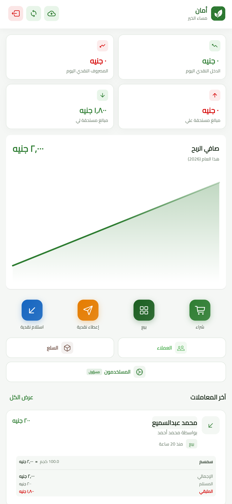
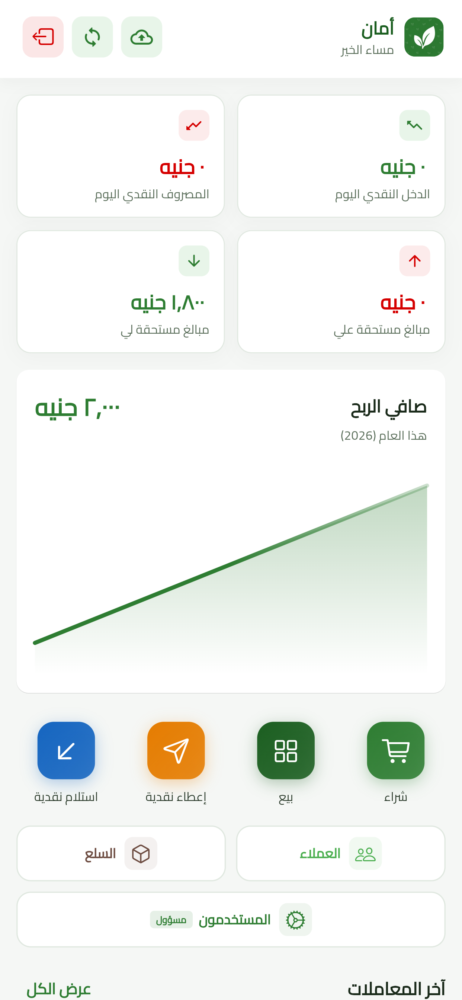
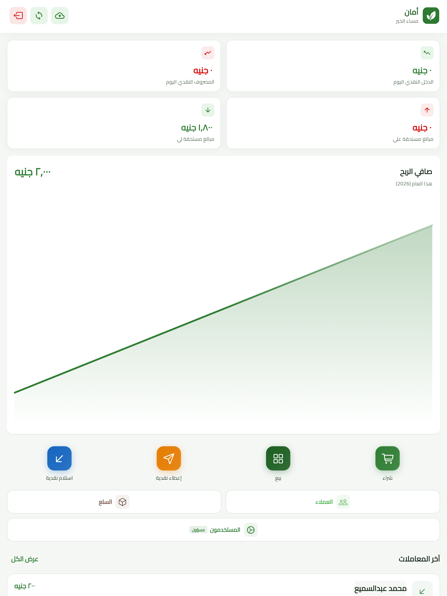
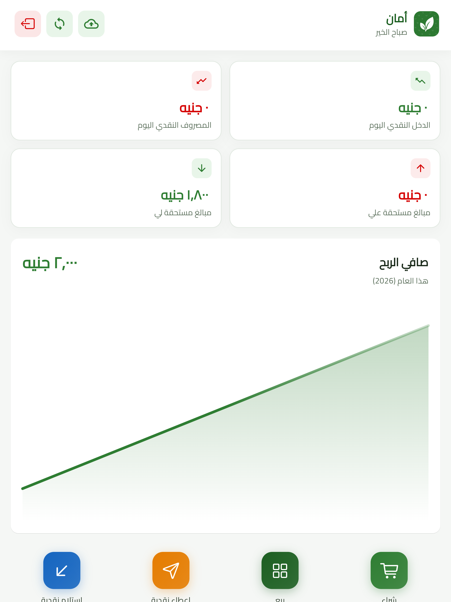

# Responsive Zoom

**Responsive Zoom: Build Once, Scale Everywhere**

A tiny, dependency-free Flutter widget that makes your entire app responsive by **zooming** your UI to fit any screen — instead of forcing you to sprinkle `.w`, `.h`, and `.r` on every single value.

You design for one reference screen size (or one per aspect ratio). `ResponsiveZoom` calculates a zoom factor from the real device size and scales your whole widget tree to match — layout, text, radii, paddings, everything — with zero changes to your widget code.

Version 1.1.0 adds **multiple reference sizes with smooth blending** between aspect ratios, and a **`ResponsiveBuilder`** for arranging widgets differently on portrait, landscape and square screens.

---

## Why

Most "responsive" packages ask you to rewrite every number in your UI:

```dart
Container(
  width: 80.w,
  height: 30.h,
  decoration: BoxDecoration(
    color: Colors.grey.shade200,
    borderRadius: BorderRadius.circular(6.r),
  ),
  margin: const EdgeInsets.symmetric(horizontal: 12.w),
),
```

That's noisy, easy to forget, and turns every PR into a `.w`/`.h`/`.r` hunt.

With **Responsive Zoom**, you just write normal, plain Flutter numbers:

```dart
Container(
  width: 80,
  height: 30,
  decoration: BoxDecoration(
    color: Colors.grey.shade200,
    borderRadius: BorderRadius.circular(6),
  ),
  margin: const EdgeInsets.symmetric(horizontal: 12),
),
```

No more `.w`. No more `.h`. No more `.r`. **Just write the numbers.**

The scaling happens once, at the root of your app, not on every widget.

---

## Before / After

### Phone screen — `1242x2688`

| Without `ResponsiveZoom` | With `ResponsiveZoom` |
|---|---|
|  |  |

### Large screen — `2064x2752`

| Without `ResponsiveZoom` | With `ResponsiveZoom` |
|---|---|
|  |  |

Without the wrapper, layouts built for one reference size look cramped or oversized on other devices. With `ResponsiveZoom`, the same widget tree scales cleanly to fill and fit every screen, with no per-widget changes.

---

## Responsive Zoom vs. `flutter_screenutil`

| | `flutter_screenutil` | `ResponsiveZoom` |
|---|---|---|
| Setup | Wrap app + call `.init()` | Wrap app only |
| Usage | `.w`, `.h`, `.r`, `.sp` on every value | Plain numbers everywhere |
| Widget code | Coupled to the package | Untouched, portable Flutter |
| Text scaling | Manual (`.sp`) | Scales automatically with the rest of the UI |
| Mental overhead | High — remember the right extension per value | None |
| Different designs per aspect ratio | Not built in | Reference size per aspect ratio, blended smoothly |

---

## How it works

`ResponsiveZoom` computes a single `zoom` factor by comparing the device's real (logical) screen size to a reference size you define:

1. It takes the real screen size (physical size ÷ device pixel ratio).
2. For one reference size, the zoom is `shortSide / referenceShortSide`.
3. With several reference sizes (one per aspect ratio), it finds the two whose aspect ratios surround the screen's ratio and **blends** their zoom values linearly. The zoom changes smoothly as the aspect ratio changes, with no sudden jumps.
4. Outside the range of configured ratios, the nearest reference size is used.

The `zoom` value is then applied via `FittedBox` + `ConstrainedBox` (to scale the rendered layout) and propagated through an adjusted `MediaQuery` (so `MediaQuery.of(context).size`, padding, and view insets all stay consistent with the zoomed layout).

---

## Installation

```bash
flutter pub add responsive_zoom
```

Then import it wherever you need it:

```dart
import 'package:responsive_zoom/responsive_zoom.dart';
```

That's it — no `.init()` call required.

---

## Usage

### 1. Wrap your app

Just wrap the root of your app with `ResponsiveZoom`:

```dart
ResponsiveZoom(
  child: MaterialApp(
    title: 'Responsive Zoom Example',
    home: const HomePage(),
  ),
)
```

### 2. (Optional) Set reference sizes

If you don't set anything, the default reference size `450x960` is used. To use your own, set them once, preferably in `main()` before `runApp`.

**One reference size per aspect ratio.** Keys are aspect ratios (`width / height`):

```dart
void main() {
  ResponsiveZoom.setReferenceSizes({
    9 / 16: Size(450, 960),   // portrait phones
    1: Size(700, 700),        // square-ish (tablets, foldables)
    16 / 9: Size(960, 450),   // landscape
  });

  runApp(const MyApp());
}
```

**Or use the ready-made `ScreenRatio` values:**

```dart
void main() {
  ResponsiveZoom.setReferenceSizesByDevice({
    ScreenRatio.phoneTall: Size(390, 844),
    ScreenRatio.phone: Size(450, 960),
    ScreenRatio.iPad: Size(820, 1180),
  });

  runApp(const MyApp());
}
```

`setReferenceSizesByDevice` covers portrait ratios. To add landscape, use `setReferenceSizes` with `ScreenRatio.x.value` (portrait) and `ScreenRatio.x.landscape`:

```dart
ResponsiveZoom.setReferenceSizes({
  ScreenRatio.phone.value: Size(450, 960),
  ScreenRatio.phone.landscape: Size(960, 450),
  ScreenRatio.iPad.value: Size(820, 1180),
  ScreenRatio.iPad.landscape: Size(1180, 820),
});
```

Between two configured ratios the zoom is interpolated, so rotating a device or resizing a window scales the UI smoothly.

### 3. Write plain Flutter — nothing else changes

Every widget underneath `ResponsiveZoom` is written with normal numbers, exactly as you would for a single fixed-size screen:

```dart
Container(
  width: 80,
  height: 30,
  decoration: BoxDecoration(
    color: Colors.grey.shade200,
    borderRadius: BorderRadius.circular(6),
  ),
  margin: const EdgeInsets.symmetric(horizontal: 12),
),
```

---

## ScreenRatio

Common portrait aspect ratios (`width / height`). Use `value` for the portrait ratio and `landscape` for the rotated one.

| Value | Ratio | Example devices |
|---|---|---|
| `phone` | 9:16 (0.5625) | iPhone 6/7/8/SE, Galaxy S5–S7, Pixel 1/2 |
| `phoneTall` | 9:19.5 (0.4615) | iPhone X–16, Galaxy S21–S24 |
| `phoneUltraTall` | 9:21 (0.4286) | Sony Xperia 1 and 5 series |
| `tablet` | 10:16 (0.625) | Galaxy Tab S4/S5e/S7–S9, Nexus 7 (2013) |
| `iPad` | 3:4 (0.75) | iPad 9.7" and 10.2", iPad Air 1–3, iPad Pro 12.9" |
| `iPadPro` | 1668:2388 (≈0.698) | iPad Pro 11", iPad Air 10.9", iPad 10th gen |
| `foldable` | 1812:2176 (≈0.833) | Galaxy Z Fold 5 inner screen, Pixel Fold |
| `dualScreen` | 1892:2688 (≈0.704) | Microsoft Surface Duo 2 (both screens) |
| `square` | 1:1 | Square displays |

Device lists are examples, not exhaustive. Real devices differ slightly because of system bars and rounding, but blending handles that smoothly, so you don't need an exact match. `iPadPro` and `dualScreen` sit very close together, so you normally define only one of them.

---

## ResponsiveBuilder

Because zoom normalizes sizes, the only thing left to decide is the **shape** of the screen. `ResponsiveBuilder` classifies the real screen by aspect ratio into a `ScreenType` and rebuilds when it changes (rotation, window resize, foldables). Place it **under** `ResponsiveZoom`.

| `ScreenType` | When |
|---|---|
| `portrait` | `width / height` below 0.9 |
| `landscape` | `width / height` above 1.1 |
| `square` | `width / height` from 0.9 to 1.1 |

`ScreenType` has `isPortrait`, `isLandscape`, `isSquare`, and `pick(...)`, which chooses a value by type and falls back (square → landscape → portrait) when a value is missing.

### Full control

```dart
ResponsiveBuilder(
  builder: (context, type) {
    final columns = type.pick(portrait: 1, landscape: 3, square: 2);
    return ProductGrid(columns: columns);
  },
)
```

### Column on portrait, row on landscape (animated)

The same children move between a column and a row. When the screen type changes they **glide** to their new positions and sizes, and keep their state.

```dart
ResponsiveBuilder.columnOnPortraitRowOnLandscape(
  spacing: 16,
  flexes: [2, 3], // optional, default: equal shares
  children: [
    ProductImage(),
    ProductDetails(),
  ],
)
```

Options: `flexes`, `spacing`, `squareAxis` (what square screens do, default horizontal), `duration`, `curve`.

Children fill their cell, so don't wrap them in `Expanded`; use `flexes` instead. Use curves that don't overshoot (`easeInOutCubic`, `fastOutSlowIn`).

### A different layout per screen type (crossfade)

```dart
ResponsiveBuilder.layoutPerScreenType(
  portrait: (_) => const PortraitHome(),
  landscape: (_) => const LandscapeHome(),
  // square omitted -> uses the landscape layout
)
```

Only the active layout is built. Set `duration: Duration.zero` to switch instantly.

> Both ready blocks need bounded space (for example a `Scaffold` body or a `SizedBox`). Don't put them directly inside a scroll view without giving them a height.

---

## API

### ResponsiveZoom

| Member | Description |
|---|---|
| `ResponsiveZoom({required Widget child})` | Wraps your app (or any subtree) and applies the computed zoom factor to it. |
| `ResponsiveZoom.setReferenceSizes(Map<double, Size>)` | Sets reference sizes keyed by aspect ratio (`width / height`). Zoom blends between neighboring keys. |
| `ResponsiveZoom.setReferenceSizesByDevice(Map<ScreenRatio, Size>)` | Same as above, keyed by `ScreenRatio`. |
| `ResponsiveZoom.clearReferenceSizes()` | Removes all configured reference sizes. |
| `ResponsiveZoom.defaultReferenceSize` | The fallback reference size, `450x960`. |
| `ResponsiveZoom.realScreenSize` | The device's real (logical) screen size — physical size ÷ device pixel ratio. |
| `ResponsiveZoom.zoom` | The zoom factor for the current screen. |
| `ResponsiveZoom.zoomFor(Size)` | The zoom factor for any given screen size. |
| `ResponsiveZoom.setReferenceSize({Size? referenceSize})` | **Deprecated.** Use `setReferenceSizes`. |
| `ResponsiveZoom.referenceSize` | **Deprecated**, now nullable. |

Priority: `setReferenceSizes` / `setReferenceSizesByDevice` → deprecated `referenceSize` → `defaultReferenceSize`.

### ScreenRatio

| Member | Description |
|---|---|
| `value` | Portrait aspect ratio (`width / height`). |
| `landscape` | The rotated ratio (`height / width`). |

### ResponsiveBuilder

| Member | Description |
|---|---|
| `ResponsiveBuilder(builder: (context, type) => ...)` | Builds from the current `ScreenType`. |
| `ResponsiveBuilder.columnOnPortraitRowOnLandscape(...)` | Animated column ↔ row block. |
| `ResponsiveBuilder.layoutPerScreenType(...)` | A different layout per screen type, with a crossfade. |

### ScreenType

| Member | Description |
|---|---|
| `portrait`, `landscape`, `square` | The three screen shapes. |
| `isPortrait`, `isLandscape`, `isSquare` | Convenience getters. |
| `pick(portrait:, landscape:, square:)` | Chooses a value by type, with fallback. |

---

## Migrating from 1.0.x

Nothing breaks. `setReferenceSize` and `referenceSize` still work, but are deprecated:

```dart
// Before
ResponsiveZoom.setReferenceSize(referenceSize: const Size(375, 812));

// After
ResponsiveZoom.setReferenceSizes({9 / 19.5: Size(375, 812)});
```

With a single reference size the zoom is unchanged from 1.0.x.

---

## Notes

- Set reference sizes **once**, at startup, before `runApp`. Changing them at runtime is not the intended use case.
- Because scaling is applied at the root via `FittedBox`/`MediaQuery`, text, icons, paddings, and radii all scale together and stay visually consistent — no separate `.sp` handling needed.
- `ResponsiveBuilder` uses the real screen's aspect ratio, so a builder inside a side pane or dialog sees the whole screen's shape, not the pane's.
